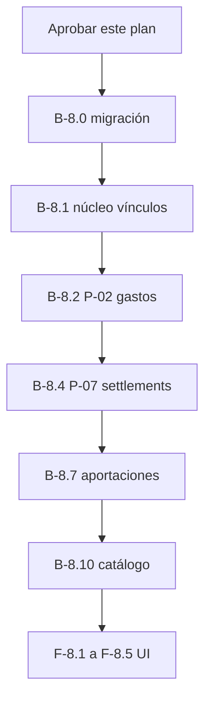

# Plan técnico — Fase 8 (B-8 / F-8)

**Estado:** **APROBADO** (2026-11-18, producto + coordinación; resoluciones §10).  
**Gate:** cerrado — backend puede **B-8.0** (borrador migración → revisión coordinación → aplicar).

Fuentes: [decisions.md §2e](../product/decisions.md#2e-decisiones-aprobadas--fase-8-cuentas-vinculadas-2026-11-18), [accounts-model.md](../product/accounts-model.md), [database-design.md](../architecture/database-design.md), [security.md](../architecture/security.md).

---

## 1. Objetivo

Conectar **flujo de caja personal** con operaciones del espacio **SHARED**, sin romper aislamiento por `spaceId` ni filtrar cuentas personales a otros miembros:

| Decisión | Comportamiento |
| -------- | -------------- |
| **P-02** | Pagador opcional: salida del **total** en su PERSONAL al crear/editar/anular gasto `MEMBER`. |
| **P-07** | Liquidación: movimiento opcional en **el lado del actor** (salida `from`, entrada `to`); el acreedor confirma su entrada si el deudor registró. |
| **P-05** | Aportación a cuenta común: `INCOME` con **aportante**; sin deudas. |
| **P-06** | Personal ↔ común en **una transacción BD**, dos movimientos vinculados. |

Fuera de alcance de la fase 8: presupuestos/dashboard (P-17, fase 9), notificaciones push/email (solo in-app en MVP fase 8).

---

## 2. Principios de diseño

1. **Cada `FinancialTransaction` sigue viviendo en un solo espacio** (FK compuestas intactas).
2. **El vínculo cross-space es una entidad aparte**, no una FK directa desde SHARED hacia cuenta personal.
3. **Respuestas del espacio SHARED** no incluyen `accountId`, nombres de cuenta, `personalTransactionId` ni saldos del PERSONAL ajeno.
4. **El titular del PERSONAL** es quien puede crear/anular el movimiento de su lado; la API valida `user.personalSpaceId` + titularidad de la cuenta.
5. **Propagación de ciclo de vida:** editar importe/fecha del gasto o anular propaga al movimiento personal P-02; anular liquidación anula movimientos personales vinculados de ambos lados (si existen).
6. **Tipos de movimiento personal vinculados:** marcar con metadata de enlace (categoría opcional fija «Flujo entre espacios» o flag en el vínculo); no son consumo (P-17) — etiquetado en fase 9.
7. **Dinero:** `Prisma.Decimal`; mismas reglas de moneda que el padre (gasto/liquidación/aportación).

---

## 3. Modelo de datos (migración B-8.0)

**Nombre propuesto:** `20261201120000_phase8_cross_space_cash_links` (fecha final al aprobar).

### 3.1 Tabla `cross_space_cash_links`

| Columna | Tipo | Notas |
| ------- | ---- | ----- |
| `id` | UUID PK | |
| `kind` | enum | `SHARED_EXPENSE_MEMBER_PAYMENT`, `SETTLEMENT_FROM_OUT`, `SETTLEMENT_TO_IN`, `CONTRIBUTION_PAIR` |
| `owner_user_id` | UUID FK users | Titular del movimiento personal |
| `personal_transaction_id` | UUID FK financial_transactions UNIQUE | Siempre en el espacio PERSONAL del `owner_user_id` |
| `shared_space_id` | UUID FK spaces | Espacio SHARED ancla |
| `shared_expense_id` | UUID NULL FK | Exclusivo con `settlement_id` salvo `CONTRIBUTION_PAIR` |
| `settlement_id` | UUID NULL FK | |
| `contribution_group_id` | UUID NULL | Mismo valor en los dos lados de P-06 |
| `created_at` | timestamptz | |

**CHECK (SQL):**

- Exactamente una ancla de negocio: (`shared_expense_id` IS NOT NULL) XOR (`settlement_id` IS NOT NULL) XOR (`kind = CONTRIBUTION_PAIR` con `contribution_group_id`).
- `personal_transaction_id` debe pertenecer al `personal_space_id` del `owner_user_id` (trigger o deferido).
- Tipos de transacción personales permitidos: `EXPENSE` (salidas P-02, P-07 from, aportación salida), `INCOME` (P-07 to, aportación entrada en personal si aplica).

**Índices:** `(shared_expense_id)`, `(settlement_id)`, `(owner_user_id)`, `(contribution_group_id)`.

No añadir columnas `financialTransactionId` en `settlements` visibles en listados SHARED; el enlace vive solo en esta tabla + consultas filtradas por usuario.

### 3.2 Aportaciones (P-05) — `financial_transactions`

Relajar CHECK de `INCOME` en espacio **SHARED**:

- Permitir `attributed_to_user_id IS NOT NULL` **solo** cuando el espacio es SHARED y existe fila en `cross_space_cash_links` de tipo `CONTRIBUTION_PAIR` en el COMMIT, **o** mediante categoría/flag documentado en integridad.
- `attributed_to_user_id` debe ser miembro con historial en el espacio (misma semántica que P-19 para liquidaciones, simplificada a ACTIVE o histórico según decisión en revisión de migración).

### 3.3 Sin cambios en P-01

No se añade `ownerUserId` en `Account`.

### 3.4 Integridad

- Actualizar `apps/api/prisma/sql/custom-integrity.sql` y tests `test/database/`.
- Nuevos triggers deferidos: coherencia moneda/importe entre padre SHARED y tx PERSONAL (tolerancia 0; importe personal = total gasto para P-02, = settlement.amount para P-07).
- Anulación: void del padre → void de txs personales enlazadas + enlaces inactivos o enlaces que apuntan a txs anulados (mismo patrón que `SPACE_ACCOUNT`).

**Aprobación requerida:** SQL completo de la migración en PR dedicado antes de `migrate deploy`.

---

## 4. Entregas backend (orden)

| ID | Contenido | Aceptación |
| -- | --------- | ---------- |
| **B-8.0** | Migración + `custom-integrity.sql` + `test:db` | Coordinación aprueba SQL |
| **B-8.1** | Servicio de dominio `CrossSpaceCashLink` (crear/void/actualizar importe) + helpers titularidad | Unit tests permisos |
| **B-8.2** | **P-02** — Extender `POST/PATCH /shared-expenses`; `POST …/link-personal-payment` (pagador posterior) | Una transacción; 403 si no es pagador; sin `personalAccountId` en respuesta SHARED para otros; integración + no filtración |
| **B-8.3** | **P-02** — Propagación en void/PATCH importe/fecha | Paridad con `SPACE_ACCOUNT` |
| **B-8.4** | **P-07** — Extender `POST /settlements` con `personalCashFlow?: { accountId }` (solo lado del `recordedBy` si es `from` o `to`) | 201 sin exponer cuenta del otro |
| **B-8.5** | **P-07** — `POST /settlements/:id/link-personal-cash-flow` para contraparte (`from` o `to`, no el registrador original) | 403 si actor no es la parte; entrada acreedor |
| **B-8.6** | **P-07** — Void settlement → void txs personales enlazadas | Integración |
| **B-8.7** | **P-05/P-06** — `POST /spaces/:spaceId/contributions` (body: `sharedAccountId`, `amount`, `currency`, `occurredAt?`, `personalAccountId?`, `note?`) | Dos movimientos + `contribution_group_id`; solo titular inicia desde personal |
| **B-8.8** | Lecturas PERSONAL: `GET` detalle/listado de transacciones incluye `crossSpaceSummary?` **solo** en espacio PERSONAL del usuario | Nunca en rutas SHARED |
| **B-8.9** | **P-07 hint** — `GET /spaces/:spaceId/settlements/link-hints` o similar (opcional) | **Fuera de MVP fase 8:** sugerencia de cuenta en **front** (última cuenta usada en vínculos del usuario); B-8.9 solo si hace falta en implementación |
| **B-8.10** | OpenAPI + [frontend-api-dependencies.md](./frontend-api-dependencies.md) | Códigos de error nuevos listados abajo |

### Códigos de error nuevos (propuesta)

| code | HTTP |
| ---- | ---- |
| `PERSONAL_ACCOUNT_REQUIRED` | 400 |
| `PERSONAL_ACCOUNT_NOT_OWNED` | 403 |
| `PERSONAL_LINK_NOT_ALLOWED` | 403 |
| `PERSONAL_LINK_ALREADY_EXISTS` | 409 |
| `NOT_PAYER` | 403 |
| `CROSS_SPACE_CURRENCY_MISMATCH` | 400 |
| `CONTRIBUTION_NOT_ALLOWED` | 403 |

---

## 5. Contratos REST (resumen)

### 5.1 Alta gasto compartido — extensión `payment` (`MEMBER`)

```json
"payment": {
  "source": "MEMBER",
  "paidByUserId": "uuid",
  "personalAccountId": "uuid"
}
```

- `personalAccountId` opcional.
- Solo si `paidByUserId === actorUserId` (quien envía la petición es el pagador).
- Crea `EXPENSE` en PERSONAL por `totalAmount` + fila `cross_space_cash_links` (`SHARED_EXPENSE_MEMBER_PAYMENT`).

### 5.2 Vincular pago posterior (pagador)

`POST /spaces/:spaceId/shared-expenses/:id/link-personal-payment`

```json
{ "personalAccountId": "uuid", "expectedVersion": 1 }
```

Solo `paidByUserId === actor`; gasto no anulado; sin enlace previo.

### 5.3 Liquidación — extensión

`POST /spaces/:spaceId/settlements`

```json
{
  "fromUserId": "uuid",
  "toUserId": "uuid",
  "amount": "40.00",
  "currency": "EUR",
  "occurredAt": "2026-11-18T12:00:00.000Z",
  "personalCashFlow": { "accountId": "uuid" }
}
```

- `personalCashFlow` opcional: válido solo si `actorUserId` es `fromUserId` (→ salida) o `toUserId` (→ entrada).
- Si `actorUserId` es solo el registrador pero no parte del par, no puede enviar `personalCashFlow`.

### 5.4 Vincular cobro/pago tras registro ajeno

`POST /spaces/:spaceId/settlements/:id/link-personal-cash-flow`

```json
{ "accountId": "uuid", "expectedVersion": 1 }
```

- Actor debe ser `from` o `to` y **no** haber vinculado ya su lado.
- Entrada típica: acreedor confirma Bizum (P-07 UX).

### 5.5 Respuesta SHARED `Settlement` (sin cambios sensibles)

Mantiene campos actuales. Añadir **solo para el usuario de la sesión** en detalle (no en listado masivo de otros):

```json
"myPersonalCashLink": {
  "linked": true,
  "canLink": false,
  "side": "to"
}
```

O mover `canLink` a endpoint ligero para no ensuciar listados — decisión implementación B-8.5/F-8.4.

### 5.6 Aportación

`POST /spaces/:spaceId/contributions` — ver B-8.7.

---

## 6. Entregas frontend (tras catálogo B-8.x)

| ID | Contenido | Aceptación |
| -- | --------- | ---------- |
| **F-8.1** | Gasto compartido: selector «Pagado desde mi cuenta» (solo si yo soy pagador); lista de cuentas del espacio PERSONAL vía API existente de cuentas personales | Oculto si pagador ≠ yo; mensaje para «vincular después» |
| **F-8.2** | Detalle gasto: CTA pagador «Vincular pago personal» si `MEMBER` sin enlace | 409/403 manejados |
| **F-8.3** | Liquidación (F-7.2 extendido): checkbox + cuenta en **mi** lado; copia P-07 | «Registrar pago» sin «Confirmar» |
| **F-8.4** | Aviso in-app al acreedor: liquidación donde soy `to` y `canLink` (banner en Saldos / listado liquidaciones) | Confirmar → `link-personal-cash-flow`; sugerir cuenta |
| **F-8.5** | Flujo aportación a cuenta común (desde detalle cuenta SHARED o acción en finanzas) | P-05/P-06 |
| **F-8.6** | Movimientos PERSONAL: badge/enlace «Relacionado con [espacio] / liquidación / gasto» (solo lectura) | Sin datos de terceros |
| **F-8.7** | RTL + ajuste E2E opcional (escenario P-02 + P-07 en local; CI fase 10) | |

**Datos de cuentas personales en forms SHARED:** cargar cuentas con `GET` del espacio PERSONAL del usuario (ya autenticado), nunca desde respuestas de gastos SHARED.

---

## 7. Privacidad y pruebas

| Prueba | Descripción |
| ------ | ----------- |
| No filtración SHARED | Miembro A no ve `personalAccountId` / tx ids del PERSONAL de B en `GET shared-expenses`, listados settlements, balances |
| IDOR personal | Cuenta de otro usuario → 403/404 |
| Titularidad vínculo | Carlos no puede llamar `link-personal-payment` en gasto pagado por Ana |
| Integración P-02 | 120 € / 3 → −120 pagador; deudas sin cambio |
| Integración P-07 | Carlos registra 40 € → Ana `link-personal-cash-flow` +40 |
| Void en cadena | Anular gasto o liquidación restaura saldos personales |
| `test:db` | CHECK + triggers nuevos |

Referencia: [testing-strategy.md](./testing-strategy.md).

---

## 8. Criterios de terminado (fase 8)

1. Escenarios E1, E4, E5, E6 de [accounts-model.md](../product/accounts-model.md) cubiertos por API + UI mínima.
2. §8 de [shared-expenses.md](../product/shared-expenses.md) sigue válido; ejemplo ampliado con P-02/P-07 en UI.
3. Migración aplicada en dev; `test:db` y suites API en verde.
4. Catálogo y OpenAPI actualizados.
5. `roadmap.md` fase 8 ✅; `current-status.md` apunta a fase 9 o deuda menor.

---

## 9. Orden de ejecución entre chats



**Orden obligatorio en fase 8:** B-8.2 (P-02) → B-8.4–6 (P-07) → B-8.7 (P-05/06), misma migración B-8.0; no abrir fase 9 hasta cerrar las tres olas.

---

## 10. Resoluciones de implementación (cerradas 2026-11-18)

| Tema | Decisión |
| ---- | -------- |
| Modelo de vínculo | **`cross_space_cash_links`**; no FKs de transacciones personales en filas `settlements` expuestas al SHARED (privacidad + listados uniformes). |
| Cuenta sugerida al cobrar | **Heurística en front** en v1; **B-8.9 en API** diferido salvo necesidad técnica demostrada. |
| Aviso acreedor (P-07) | **Saldos y listado de liquidaciones** (F-8.4): mismo componente/acción `link-personal-cash-flow`. |
| Alcance y orden fase 8 | **P-02 → P-07 → P-05/P-06** en el mismo tren; B-8.7 tercera ola, no fase 8.1 aparte. |

Documento **APROBADO**; gate de producto para codificar fase 8 **abierto**.