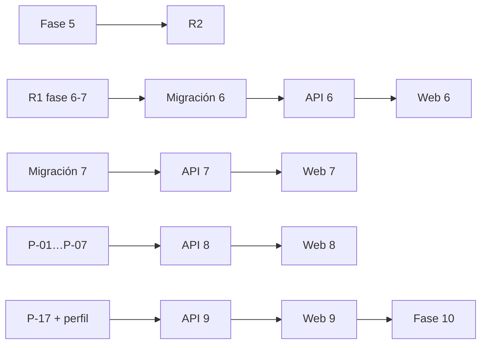

# Roadmap de Wealthspace

Estado real del proyecto (verificado contra el código el **2026-11-18**) y plan de fases. Detalle por área: [roadmap-backend.md](./roadmap-backend.md) · [roadmap-frontend.md](./roadmap-frontend.md). Estado operativo: [current-status.md](./current-status.md). Decisiones: [decisions.md](../product/decisions.md).

Leyenda: ✅ hecho y verificado · 🟡 parcial · ⬜ pendiente · 🔧 refactorización · ✨ funcionalidad nueva.

---

## 1. Resumen de estado

| Fase | Contenido                                                      | API | Web | Notas                                                     |
| ---- | -------------------------------------------------------------- | --- | --- | --------------------------------------------------------- |
| 0    | Monorepo, CI, esquema y migración inicial, tests de integridad | ✅  | ✅  | E2E Playwright **no** en CI (fase 10).                    |
| 1    | Fundación backend                                              | ✅  | —   |                                                           |
| 2    | Autenticación API                                              | ✅  | —   | Sin `PATCH` perfil/zona horaria.                          |
| 3    | Autenticación web                                              | —   | ✅  | E2E auth local.                                           |
| 4    | Espacios, invitaciones, membresía                              | ✅  | 🟡  | **4.2 C-05** aprobado; UI confirmación fuerte pendiente.  |
| 5    | Cuentas, categorías, movimientos                               | ✅  | ✅  | Gasto individual + compartido en rutas distintas.         |
| R1   | Cierre decisiones producto fases 6–7                           | ✅  | ✅  | P-03…P-16 y P-10…P-19 aprobados.                          |
| R2   | Alineación fase 5 (F-R2, C-01…C-04)                            | ✅  | ✅  |                                                           |
| 6    | Gastos compartidos con reparto                                 | ✅  | ✅  | Migraciones `20261115183000`.                             |
| 7    | Saldos y liquidaciones                                         | ✅  | ✅  | Migración `20261117160000`; E2E SHARED local.             |
| 4.1  | Transferencia de ownership                                     | ✅  | ✅  | B-4.1 + F-4.1.                                            |
| 8    | Cuentas personales vinculadas y aportaciones                   | ⬜  | ⬜  | Plan fase 8 ✅; en curso **B-8.0+**. |
| 9    | Presupuestos, informes y dashboard                             | ⬜  | ⬜  | P-17 aprobado; falta perfil/`Budget`.                     |
| 10   | Preparación para producción                                    | ⬜  | ⬜  | E2E en CI, hardening, despliegue.                         |

### Lo que el MVP financiero compartido ya cubre

- Registro, auth, espacios SHARED, invitaciones, cuentas y movimientos por espacio.
- **Gasto individual** en SHARED (P-14/C-04) y **gasto compartido** con tres métodos de reparto, preview, edición, anulación e historial (P-09, P-13, P-16).
- **Saldos** netos por par y por miembro; **liquidaciones** parciales/completas con aviso de sobrepago (P-11) y ex-miembros (P-19).
- Transferencia de ownership; aviso informativo de saldo al leave/remove (P-19).
- Integridad SQL en migraciones fase 6 y 7; tests de API e integridad BD.

### Parcial o pendiente menor (no bloquea fase 8)

| Tema                                          | Estado                                            |
| --------------------------------------------- | ------------------------------------------------- |
| Edición de perfil y `timezone`                | Campo en BD; sin endpoint ni UI                   |
| Presupuestos (`Budget`)                       | Solo esquema                                      |
| E2E en CI                                     | Spec fases 6–7 existe; no corre en pipeline       |
| Deuda técnica API                             | Errores Prisma/trigger sin `code` → 500 ocasional |
| Paginación cursor, renombrar cuenta/categoría | Fuera de prioridad                                |

### Refactorización histórica (cerrada)

Las filas de migración fase 6–7 (PaymentSource, participantes, void, settlements) están **aplicadas**; no quedan refactorizaciones obligatorias de las fases 5–7 salvo bugs.

## 2. Dependencias

Regla: **API antes que web** en cada fase nueva.

## 3. Fases pendientes y criterios de aceptación

### R1 — ✅ Cerrado (2026-11-15 / 2026-11-17)

Decisiones fases 6 y 7 aprobadas; migraciones 6 y 7 revisadas/aplicadas en desarrollo.

### R2 — ✅ Cerrado

F-R2.1…F-R2.6 completados.

### Fases 6 y 7 — ✅ Cerradas en código

Criterios de aceptación: ver [shared-expenses.md](../product/shared-expenses.md) §8 y roadmap §historical; verificados con tests API + E2E local `shared-expenses-balances-settlements.spec.ts`.

### Fase 8 — ✨ Cuentas personales vinculadas

**Plan:** [phase-8-technical-plan.md](./phase-8-technical-plan.md) **APROBADO** (2026-11-18). Decisiones P-01…P-07 en [decisions.md §2e](../product/decisions.md#2e-decisiones-aprobadas--fase-8-cuentas-vinculadas-2026-11-18). Referencia: [accounts-model.md](../product/accounts-model.md).

**Aceptación (provisional):** P-02 (salida del pagador al adelantar); P-05/P-06 (aportaciones y personal↔común); P-07 (vínculos de liquidación por lado + UX que facilite entrada al acreedor); tests de no filtración en respuestas SHARED.

### Fase 9 — ✨ Presupuestos, informes y dashboard

**Gate:** P-17 + `PATCH` perfil/timezone. Consumo vs flujo de caja según decisión.

### Fase 10 — Producción

E2E en CI, rate limiting, revisión de seguridad, backups, políticas.

### 4.2 — Último miembro ACTIVE

**C-05 aprobado:** leave permitido con confirmación fuerte (no 409 `LAST_ACTIVE_MEMBER`). Pendiente implementación en web.

## 4. Riesgos activos

| Riesgo                                           | Mitigación                                          |
| ------------------------------------------------ | --------------------------------------------------- |
| Migración B-8.0 sin revisión                     | Borrador → coordinación → aprobar → aplicar           |
| Fuga de datos al vincular cuentas personales     | Tests de no filtración obligatorios en B-8          |
| Informes sin P-17                                | No iniciar presupuestos/dashboard                   |
| Drift de migraciones                             | `test:db` en CI; borrador → aprobación coordinación |
| Regresiones flujo SHARED                         | Mantener E2E local; incorporar a CI en fase 10      |

## 5. Reglas de ejecución

Sin cambios: ver secciones anteriores del documento (una entrega a la vez, no inventar reglas, actualizar `current-status.md` y catálogo al cerrar).

## 6. Definición de terminado

1. Criterios de la fase cumplidos y tests en verde.
2. Contratos en `frontend-api-dependencies.md` si hay API nueva.
3. `current-status.md` con la siguiente tarea por chat.
