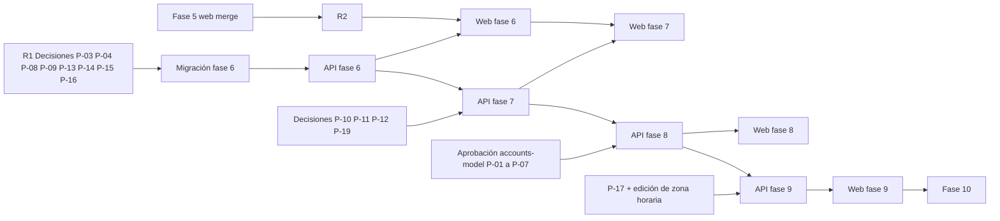

# Roadmap de Wealthspace

Estado real del proyecto (verificado contra el código el **2026-11-15**) y plan de fases. Detalle por área: [roadmap-backend.md](./roadmap-backend.md) · [roadmap-frontend.md](./roadmap-frontend.md). Estado operativo del día a día: [current-status.md](./current-status.md). Decisiones: [decisions.md](../product/decisions.md).

Leyenda: ✅ hecho y verificado · 🟡 parcial · ⬜ pendiente · 🔧 refactorización (cambia algo existente) · ✨ funcionalidad nueva.

---

## 1. Resumen de estado

| Fase | Contenido                                                      | API | Web | Notas                                                                                     |
| ---- | -------------------------------------------------------------- | --- | --- | ----------------------------------------------------------------------------------------- |
| 0    | Monorepo, CI, esquema y migración inicial, tests de integridad | ✅  | ✅  | Job `database-integrity` en CI. E2E no se ejecuta en CI.                                  |
| 1    | Fundación backend (config, Prisma, health, Swagger)            | ✅  | —   |                                                                                           |
| 2    | Autenticación API (registro atómico, login, sesión, perfil)    | ✅  | —   | Sin edición de perfil ni zona horaria.                                                    |
| 3    | Autenticación web                                              | —   | ✅  | E2E de auth existe (`apps/web/e2e`), no se ejecuta en CI.                                 |
| 4    | Espacios, invitaciones, membresía                              | ✅  | ✅  | 4.1 (transferencia de ownership) y 4.2 sin implementar.                                   |
| 5    | Cuentas, categorías, movimientos                               | ✅  | 🟡  | Web en la rama `feat/web-phase-5-accounts` (3 commits sin merge + cambios sin commitear). |
| R1   | 🔧 Cierre de decisiones de producto                            | —   | —   | Coordinación. Bloquea la fase 6.                                                          |
| R2   | 🔧 Alineación de la fase 5 con el nuevo modelo                 | —   | ⬜  | Renombrar el falso «gasto compartido».                                                    |
| 6    | ✨ Gastos compartidos con reparto                              | ⬜  | ⬜  | Requiere migración.                                                                       |
| 7    | ✨ Saldos (deudas) y liquidaciones                             | ⬜  | ⬜  | Requiere migración.                                                                       |
| 8    | ✨ Cuentas personales vinculadas y aportaciones                | ⬜  | ⬜  | En análisis.                                                                              |
| 9    | ✨ Presupuestos, informes y dashboard                          | ⬜  | ⬜  | Bloqueada por P-17.                                                                       |
| 10   | Preparación para producción                                    | ⬜  | ⬜  |                                                                                           |
| 4.1  | ✨ Transferencia de ownership (paralela)                       | ⬜  | ⬜  | Diseño aprobado; no bloquea nada.                                                         |

### Funcionalidad implementada y verificada

- Registro con creación atómica de usuario, espacio PERSONAL y membresía OWNER; login/logout con cookie HttpOnly; `GET /auth/me`.
- Espacios: listar, crear SHARED, detalle, miembros; invitaciones con TTL de 7 días; leave/remove con protección del único OWNER; espacio activo en la web.
- Cuentas (crear, listar, detalle con saldo on-read, archivar), categorías, saldo inicial, ingresos, gastos, transferencias, listado y edición optimista de movimientos con revisión.
- Integridad en BD: FK compuestas, triggers de reparto y SPACE_ACCOUNT, validación temporal de liquidaciones, revisiones inmutables (tests en `apps/api/test/database/`).

### Parcialmente implementado

- **Web fase 5**: completa en su rama, pendiente de merge; cambios en curso sin commitear (selector de categorías).
- **Gasto en SHARED**: la web lo presenta como «gasto compartido», pero crea un gasto individual atribuido a un solo miembro, sin reparto ni deuda (P-14).
- **Esquema sin uso**: `SharedExpense`, `ExpenseParticipant`, `Settlement` y `Budget` existen en BD, sin API ni UI.
- **Zona horaria**: el campo existe, pero no hay endpoint para editarla.

### Requiere refactorización

| Elemento                                                                                      | Motivo                                        | Fase |
| --------------------------------------------------------------------------------------------- | --------------------------------------------- | ---- |
| Web: formulario y ruta «gasto compartido» (`/spaces/:id/expenses/new`, `createSharedExpense`) | Nombre engañoso; contradice A-06              | R2   |
| BD: `PaymentSource` `CASH`/`EXTERNAL_PERSONAL`                                                | Distinción sin efecto funcional (P-03)        | 6    |
| BD: mínimo de 2 participantes                                                                 | Impide «pago solo por otra persona» (P-15)    | 6    |
| BD: `Settlement.status` `CONFIRMED`/`CANCELLED`                                               | Sugiere una confirmación que no existe (P-12) | 7    |
| BD: validación temporal de liquidaciones                                                      | Impide saldar deudas de ex-miembros (P-19)    | 7    |
| BD/API: movimientos sin anulación                                                             | A-05 exige anular con historial (P-13)        | 6+   |
| Docs: métricas de dashboard del diseño inicial                                                | Dependen del modelo de cuentas (P-17)         | 9    |

## 2. Dependencias

Regla general: **la API de cada fase precede a su web**; la web puede maquetar con el contrato orientativo de [api-design.md](../architecture/api-design.md), pero solo integra contra endpoints reales.

## 3. Fases pendientes y criterios de aceptación

### R1 — 🔧 Cierre de decisiones (coordinación)

Aprobar o modificar en [decisions.md](../product/decisions.md) como mínimo: P-03, P-04, P-08, P-09, P-13, P-14, P-15 y P-16 (para la fase 6); P-10, P-11, P-12 y P-19 (para la fase 7).

**Aceptación:** esas decisiones están en estado APROBADA, con `shared-expenses.md` y `api-design.md` actualizados, y la migración de la fase 6 aprobada.

### R2 — 🔧 Alineación de la fase 5

- Mergear la web de la fase 5.
- Renombrar en la web el «gasto compartido» actual a «Gasto individual» y retirarlo del acceso principal del espacio (P-14).

**Aceptación:** `main` contiene la web de la fase 5; ningún texto de la UI llama «compartido» a un gasto sin reparto; la CI está en verde.

### Fase 6 — ✨ Gastos compartidos

- Migración: anulación lógica, origen de pago unificado y mínimo de participantes (según R1).
- API: preview, alta, listado, detalle, edición, anulación e historial de gastos compartidos; pagador miembro y `SPACE_ACCOUNT`.
- Web: «Añadir gasto» con los tres métodos, previsualización, listado, detalle con «tu parte», edición, anulación e historial.

**Aceptación (verificable con tests):**

1. 120 € EQUAL Ana/Carlos/María pagado por Ana → participaciones 40/40/40; el detalle muestra Carlos → Ana 40 € y María → Ana 40 €.
2. 100 € EQUAL entre 3 → 33,34/33,33/33,33 (el céntimo, al `userId` menor); la suma es exactamente 100,00.
3. PERCENTAGE que suma 99,99 → 400 `SPLIT_PERCENT_SUM_INVALID`; FIXED_AMOUNT que no suma el total → 400 `SPLIT_AMOUNT_SUM_INVALID`.
4. Ningún saldo de cuenta cambia salvo en `SPACE_ACCOUNT` (baja el saldo de la cuenta compartida).
5. Ningún flujo pide confirmación a los participantes.
6. Editar crea una revisión; una edición concurrente devuelve 409; anular excluye el gasto de totales y deudas, que sigue visible como «Anulado».
7. Usuario de otro espacio → 404; espacio PERSONAL → 400; pagador no permitido → 403.
8. El preview devuelve los mismos importes que el alta posterior.

### Fase 7 — ✨ Saldos y liquidaciones

- API: `GET /balances`; alta, listado y anulación de liquidaciones.
- Web: vista «Saldos» (quién debe a quién y saldo por miembro), «Registrar pago» con importe sugerido igual a la deuda pendiente, listado y anulación.

**Aceptación:**

1. Con el escenario de la fase 6, una liquidación Carlos → Ana de 15 € deja Carlos → Ana 25 € y María → Ana 40 €; saldo neto Ana +65 €.
2. Anular la liquidación devuelve la deuda a 40 €.
3. Si Ana debe 10 € a Carlos por otro gasto, se muestra el neto: Carlos → Ana 30 €.
4. Las deudas se separan por moneda.
5. Liquidar más de lo pendiente sigue la decisión P-11.
6. Liquidación con un usuario que no era miembro en `occurredAt` → 400 (con la excepción que fije P-19).

### Fase 8 — ✨ Cuentas personales vinculadas y aportaciones

Requiere aprobar [accounts-model.md](../product/accounts-model.md). Alcance recomendado: pago desde cuenta personal con movimiento vinculado (P-02), aportaciones con aportante (P-05), movimientos personal ↔ compartida (P-06) y, opcionalmente, liquidaciones vinculadas (P-07).

**Aceptación (provisional):** Ana paga 120 € desde su cuenta personal → el saldo de su cuenta baja 120 € y la respuesta del espacio SHARED no contiene ningún dato de esa cuenta (test de no filtración); anular el gasto anula el movimiento vinculado.

### Fase 9 — ✨ Presupuestos, informes y dashboard

Requiere P-17 y un endpoint de edición de perfil y zona horaria. Presupuestos por espacio, informes mensuales en la zona horaria del usuario, dashboard global por moneda.

**Aceptación:** se definirá al aprobar P-17.

### Fase 10 — Producción

Revisión de seguridad, rate limiting, logging y monitorización, backups, migraciones de producción, E2E en CI, despliegue, política de privacidad y términos.

### 4.1 — ✨ Transferencia de ownership (paralela)

Según [spaces-membership-mvp.md](../product/spaces-membership-mvp.md). **Aceptación:** el OWNER transfiere a un miembro ACTIVE, que pasa a OWNER, y el antiguo OWNER pasa a ADMIN; queda registro de auditoría; después el antiguo OWNER puede hacer leave.

## 4. Riesgos

| Riesgo                                                                     | Mitigación                                                      |
| -------------------------------------------------------------------------- | --------------------------------------------------------------- |
| Empezar la fase 6 sin cerrar R1 → reglas inventadas por backend o frontend | Prioridad de coordinación; los chats bloquean y consultan       |
| Divergencia de redondeo entre web y API                                    | Preview desde la API (P-16); la web no calcula                  |
| Migraciones sin el bloque SQL de integridad (drift con Prisma)             | Checklist de `database-design.md`; tests `pnpm test:db` en CI   |
| Fuga de datos personales al vincular cuentas (fase 8)                      | Tests de no filtración obligatorios; DTOs separados por espacio |
| Doble conteo en informes (pago adelantado frente a consumo)                | Resolver P-17 antes de la fase 9                                |
| Ramas largas sin merge (fase 5 web)                                        | R2 al principio; PRs pequeños                                   |
| Deudas imposibles de saldar con ex-miembros                                | Decidir P-19 antes de la fase 7                                 |

## 5. Reglas de ejecución

- Una entrega a la vez; no implementar fases futuras por adelantado.
- No inventar reglas de negocio: usar `docs/product/` o marcar **PENDIENTE DE DECISIÓN** y consultar a coordinación.
- No cambiar el esquema sin una decisión aprobada y una migración aprobada.
- Tests para cada comportamiento relevante; lint, typecheck y formato en verde antes de cerrar.
- Commits pequeños (Conventional Commits en inglés); nunca push sin aprobación explícita.
- Al cerrar una entrega: actualizar [current-status.md](./current-status.md), el roadmap del área y, si cambia el contrato, [frontend-api-dependencies.md](./frontend-api-dependencies.md).

## 6. Definición de terminado

1. Implementación funcionando y cumpliendo los criterios de aceptación de la fase.
2. Tests relevantes en verde (unitarios; integración con BD en el API).
3. Lint, typecheck y formato en verde.
4. Sin cambios ajenos a la entrega.
5. Documentación y contratos actualizados.
6. Siguiente tarea identificada en `current-status.md`.
