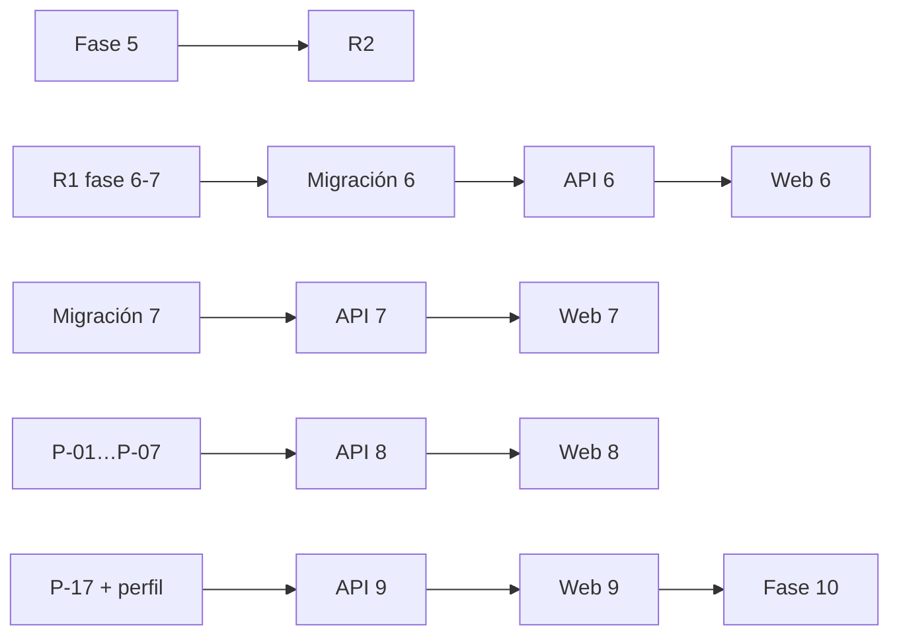

# Roadmap de Wealthspace

Estado real del proyecto (verificado contra el código el **2026-11-19**) y plan de fases. Detalle por área: [roadmap-backend.md](./roadmap-backend.md) · [roadmap-frontend.md](./roadmap-frontend.md). Estado operativo: [current-status.md](./current-status.md). Decisiones: [decisions.md](../product/decisions.md).

Leyenda: ✅ hecho y verificado · 🟡 parcial · ⬜ pendiente · 🔧 refactorización · ✨ funcionalidad nueva.

---

## 1. Resumen de estado

| Fase | Contenido                                                      | API | Web | Notas                                                     |
| ---- | -------------------------------------------------------------- | --- | --- | --------------------------------------------------------- |
| 0    | Monorepo, CI, esquema y migración inicial, tests de integridad | ✅  | ✅  | E2E Playwright **no** en CI (fase 10).                    |
| 1    | Fundación backend                                              | ✅  | —   |                                                           |
| 2    | Autenticación API                                              | ✅  | —   | `PATCH /auth/me` (B-9.1).                                 |
| 3    | Autenticación web                                              | —   | ✅  | E2E auth local.                                           |
| 4    | Espacios, invitaciones, membresía                              | ✅  | ✅  | C-05 leave último ACTIVE (F-8).                           |
| 5    | Cuentas, categorías, movimientos                               | ✅  | ✅  | Gasto individual + compartido en rutas distintas.         |
| R1   | Cierre decisiones producto fases 6–7                           | ✅  | ✅  | P-03…P-16 y P-10…P-19 aprobados.                          |
| R2   | Alineación fase 5 (F-R2, C-01…C-04)                            | ✅  | ✅  |                                                           |
| 6    | Gastos compartidos con reparto                                 | ✅  | ✅  | Migraciones `20261115183000`.                             |
| 7    | Saldos y liquidaciones                                         | ✅  | ✅  | Migración `20261117160000`; E2E SHARED local.             |
| 4.1  | Transferencia de ownership                                     | ✅  | ✅  | B-4.1 + F-4.1.                                            |
| 8    | Cuentas personales vinculadas y aportaciones                   | ✅  | ✅  | Migración `20261201120000`; ver README B-8.0.             |
| 9    | Presupuestos, informes y dashboard                             | ✅  | ✅  | MVP cerrado; mejoras opcionales en roadmaps área.         |
| 10   | Preparación para producción                                    | 🟡  | 🟡  | **Slice 1:** E2E en CI — [phase-10-slice-e2e-ci.md](./phase-10-slice-e2e-ci.md). |

### Lo que el MVP (fases 0–9) ya cubre

- Todo lo anterior hasta liquidaciones (fases 6–7) y ownership (4.1).
- **Cuentas personales vinculadas** (P-02, P-05–P-07): gastos, liquidaciones, aportaciones (fase 8).
- **Perfil** (`PATCH /auth/me`), **presupuestos**, **informe de consumo** mensual (P-17), **panel** `/dashboard` (fase 9).
- Integridad SQL migraciones 6–8; CI `quality` + `database-integrity`.

### Parcial o pendiente menor (post-MVP)

| Tema                                          | Estado                                            |
| --------------------------------------------- | ------------------------------------------------- |
| E2E Playwright en CI                          | Specs locales; slice planificado fase 10          |
| Dashboard API agregado multi-espacio          | Opcional; web compone en cliente                  |
| Presupuesto vs consumo en UI                  | Opcional (API informe + budgets listos)           |
| Deuda técnica API                             | Errores Prisma/trigger sin `code` → 500 ocasional |
| Paginación cursor, renombrar cuenta/categoría | Fuera de prioridad                                |

### Refactorización histórica (cerrada)

Las filas de migración fase 6–7 (PaymentSource, participantes, void, settlements) están **aplicadas**; no quedan refactorizaciones obligatorias de las fases 5–7 salvo bugs.

## 2. Dependencias

Regla: **API antes que web** en cada fase nueva.

## 3. Fases pendientes y criterios de aceptación

### R1 — ✅ Cerrado (2026-11-15 / 2026-11-17)

Decisiones fases 6 y 7 aprobadas; migraciones 6 y 7 revisadas/aplicadas en desarrollo.

### R2 — ✅ Cerrado

F-R2.1…F-R2.6 completados.

### Fases 6 y 7 — ✅ Cerradas en código

Criterios de aceptación: ver [shared-expenses.md](../product/shared-expenses.md) §8 y roadmap §historical; verificados con tests API + E2E local `shared-expenses-balances-settlements.spec.ts`.

### Fase 8 — ✨ Cuentas personales vinculadas

**Plan:** [phase-8-technical-plan.md](./phase-8-technical-plan.md) **APROBADO** (2026-11-18). Decisiones P-01…P-07 en [decisions.md §2e](../product/decisions.md#2e-decisiones-aprobadas--fase-8-cuentas-vinculadas-2026-11-18). Referencia: [accounts-model.md](../product/accounts-model.md).

**Aceptación (provisional):** P-02 (salida del pagador al adelantar); P-05/P-06 (aportaciones y personal↔común); P-07 (vínculos de liquidación por lado + UX que facilite entrada al acreedor); tests de no filtración en respuestas SHARED.

### Fase 9 — ✅ Presupuestos, informes y dashboard (MVP 2026-11-19)

**Gate cumplido:** P-17 + B-9.1 perfil/timezone. Detalle: roadmaps B-9 / F-9. Mejoras opcionales documentadas en `current-status.md`.

### Fase 10 — Preparación para producción

**Primer slice aprobado:** [phase-10-slice-e2e-ci.md](./phase-10-slice-e2e-ci.md) (Playwright spec fases 6–7 en CI). Resto (rate limiting, backups, despliegue) pendiente de priorización.

### 4.2 — ✅ Último miembro ACTIVE

**C-05** implementado en web (F-8).

## 4. Riesgos activos

| Riesgo                                           | Mitigación                                          |
| ------------------------------------------------ | --------------------------------------------------- |
| Entornos sin migración 8                         | README B-8.0 + checklist Release                    |
| Fuga de datos al vincular cuentas personales     | Tests de no filtración en B-8 (entregados)          |
| Regresiones flujo SHARED sin E2E en CI           | Fase 10 slice E2E; specs locales mantenidos        |
| Drift de migraciones                             | `test:db` en CI; borrador → aprobación coordinación |

## 5. Reglas de ejecución

Sin cambios: ver secciones anteriores del documento (una entrega a la vez, no inventar reglas, actualizar `current-status.md` y catálogo al cerrar).

## 6. Definición de terminado

1. Criterios de la fase cumplidos y tests en verde.
2. Contratos en `frontend-api-dependencies.md` si hay API nueva.
3. `current-status.md` con la siguiente tarea por chat.
