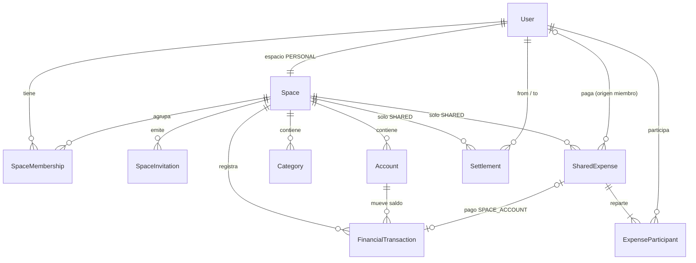

# Modelo de dominio

Entidades, relaciones y reglas de negocio. Estado de las decisiones: [decisions.md](./decisions.md). Integridad en BD: [database-design.md](../architecture/database-design.md). Esquema: [`schema.prisma`](../../apps/api/prisma/schema.prisma).

La columna **Impl.** indica si existe API/UI que use la entidad (verificado el 2026-11-15), no solo la tabla.

---

## 1. Entidades

| Entidad                | Responsabilidad                                                                                                                                                                          | Impl.             |
| ---------------------- | ---------------------------------------------------------------------------------------------------------------------------------------------------------------------------------------- | ----------------- |
| `User`                 | Persona con credenciales, `timezone` IANA y un espacio PERSONAL propio (`personalSpaceId`, 1:1).                                                                                         | Sí                |
| `Space`                | Contexto aislado de datos. `PERSONAL` (uno por usuario) o `SHARED` (grupo). `displayCurrency` opcional.                                                                                  | Sí                |
| `SpaceMembership`      | Pertenencia de un usuario a un espacio con rol (OWNER/ADMIN/MEMBER), estado (ACTIVE/LEFT/REMOVED) e intervalo `[joinedAt, leftAt)`. Las reincorporaciones crean filas nuevas.            | Sí                |
| `SpaceInvitation`      | Invitación por email a un espacio SHARED.                                                                                                                                                | Sí                |
| `Account`              | Cuenta de un espacio, con moneda y archivado. Cuenta personal = cuenta del espacio PERSONAL; cuenta compartida = cuenta de un espacio SHARED ([accounts-model.md](./accounts-model.md)). | Sí                |
| `Category`             | Categoría INCOME/EXPENSE del espacio, con jerarquía opcional.                                                                                                                            | Sí                |
| `FinancialTransaction` | Movimiento: `INCOME`, `EXPENSE`, `TRANSFER` (mismo espacio) u `OPENING_BALANCE`. Fuente de los saldos de cuenta.                                                                         | Sí                |
| `SharedExpense`        | **Gasto** compartido en SHARED: importe, moneda, pagador u origen, método de reparto.                                                                                                    | No (solo esquema) |
| `ExpenseParticipant`   | **Participación** de un usuario en un gasto compartido (`allocatedAmount`, `sharePercent`).                                                                                              | No (solo esquema) |
| `Settlement`           | **Liquidación**: pago real `from → to` registrado manualmente.                                                                                                                           | No (solo esquema) |
| Deuda                  | **No es una entidad almacenada**: se deriva de participaciones y liquidaciones (P-08).                                                                                                   | No                |
| `Budget`               | Presupuesto por espacio, categoría, periodo y moneda.                                                                                                                                    | No (solo esquema) |
| `FinancialRevision`    | Instantánea inmutable anterior a cada edición de un movimiento, gasto o liquidación.                                                                                                     | Sí (movimientos)  |

## 2. Relaciones

Reglas estructurales:

- Todo dato financiero pertenece a **un** `spaceId`. Las FK compuestas impiden mezclar cuentas o categorías de otro espacio.
- `SharedExpense` y `Settlement` solo existen en espacios SHARED (trigger).
- Un gasto compartido pagado desde una cuenta compartida (`SPACE_ACCOUNT`) se empareja con exactamente un `EXPENSE` sin atribución en esa cuenta (trigger diferido).
- Las referencias a usuarios se conservan aunque el usuario salga del espacio (sin `EconomicParty`).

## 3. Reglas de negocio por área

### 3.1 Espacios y membresía

Fuente: [spaces-membership-mvp.md](./spaces-membership-mvp.md). Autorización: membresía ACTIVE en cada operación.

### 3.2 Cuentas y movimientos (implementado)

- PERSONAL: `EXPENSE` exige cuenta; atribución siempre al titular (lo fija el servidor).
- SHARED: `EXPENSE` con `attributedToUserId` obligatorio y cuenta opcional (sin cuenta no mueve saldo). Matriz: Owner/Admin → cualquier miembro ACTIVE; Member → solo él mismo. Funcionalidad congelada (P-14).
- `INCOME` exige cuenta y no admite atribución.
- `TRANSFER` entre dos cuentas distintas del mismo espacio y la misma moneda.
- `OPENING_BALANCE`: uno por cuenta, con signo libre.
- Moneda del movimiento = moneda de la cuenta. No se puede registrar en cuentas archivadas.
- Saldo de cuenta on-read: `OPENING_BALANCE + INCOME − EXPENSE ± TRANSFER`.
- Edición: `description`, `occurredAt` y `amount`, con `expectedVersion` y revisión. No hay anulación ni borrado de movimientos (P-13).

### 3.3 Gastos compartidos, deudas y liquidaciones (pendiente de implementar)

Fuente única: [shared-expenses.md](./shared-expenses.md). Resumen:

- Reparto EQUAL (defecto), PERCENTAGE (suma 100 %) o FIXED_AMOUNT (suma = total), calculado en el servidor con el mayor resto.
- Sin confirmaciones: las deudas existen desde que se guarda el gasto.
- Deuda = participaciones de gastos pagados por un miembro − liquidaciones, neta por par y moneda.
- Liquidaciones manuales, parciales o completas, sin verificación.
- Edición y anulación con permisos e historial.

### 3.4 Presupuestos e informes (pendiente de implementar)

- Periodo mensual en `User.timezone` del consultante; filtrado por `occurredAt` (UTC).
- Solo movimientos en la moneda del presupuesto (sin FX).
- Qué cuenta como consumo frente a flujo de caja: P-17.

## 4. Glosario UI ↔ dominio

| Término en la UI                         | Concepto de dominio                                                                                                     |
| ---------------------------------------- | ----------------------------------------------------------------------------------------------------------------------- |
| Gasto compartido / Añadir gasto (SHARED) | `SharedExpense` con participantes                                                                                       |
| Gasto individual (SHARED)                | `FinancialTransaction` `EXPENSE` con `attributedToUserId` (P-14). **Hoy la web lo llama «gasto compartido» por error.** |
| Tu parte                                 | `ExpenseParticipant.allocatedAmount` del usuario                                                                        |
| Saldos / Quién debe a quién              | Deudas derivadas (P-08)                                                                                                 |
| Liquidar / Registrar pago                | `Settlement`                                                                                                            |
| Anulado                                  | Anulación lógica (P-13)                                                                                                 |

## Documentación relacionada

- [Alcance funcional](./functional-scope.md)
- [Gastos compartidos](./shared-expenses.md)
- [Modelo de cuentas](./accounts-model.md)
